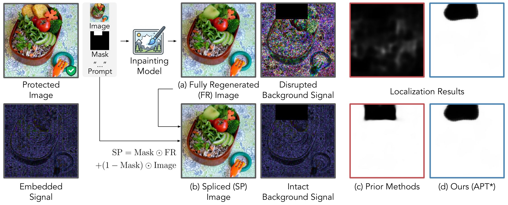

# APT: Anchor-aligned Perturbations for Tamper Localization in Fully Regenerated Images

Official implementation of our **ECCV 2026** paper.

[](https://arxiv.org/abs/2608.30656)

A semi-fragile latent-space perturbation that localizes tampering even when the entire image is regenerated by diffusion inpainting.

<p align="center">
  
</p>

## Requirements

### Installation

```bash
conda create -n apt python=3.12
conda activate apt

# 1) Install PyTorch matching your CUDA version
#    Example for CUDA 11.8:
pip install torch torchvision --index-url https://download.pytorch.org/whl/cu118

# 2) Install the remaining dependencies
pip install -r requirements.txt
```

### Weights

Download the APT checkpoints and place them under `./weights/`:

| file | description | download |
|---|---|---|
| `anchor_vecs_192.pt` | anchor vectors | [Google Drive](https://drive.google.com/file/d/1SycSoqDWUSH-V9DBmcYtmrc2IfF6hxSg/view?usp=sharing) |
| `shallow_refiner_6.pth` | mask refiner, used by APT\* | [Google Drive](https://drive.google.com/file/d/1d_zXcTqJCte17JSA-z28Z-GEmHgNsJOo/view?usp=sharing) |

```bash
mkdir -p weights
gdown 1SycSoqDWUSH-V9DBmcYtmrc2IfF6hxSg -O weights/anchor_vecs_192.pt
gdown 1d_zXcTqJCte17JSA-z28Z-GEmHgNsJOo -O weights/shallow_refiner_6.pth
```

### Data

The **valAGE-Set** benchmark is from [EditGuard](https://github.com/xuanyuzhang21/EditGuard);
download it there. Place the evaluation images and the corresponding ground-truth masks under `./data/valAGE-Set`.

```
data/
├── valAGE-Set/        # RGB images  (0001.png, 0002.png, ...)
└── valAGE-Set-Mask/   # GT masks    (0001.png, 0002.png, ...)
```

## Inference

Reproducing Table 1 is a **two-stage** process (both run by `scripts/eval.sh`):

```bash
bash scripts/eval.sh
```

1. **Embedding** — `python -m apt.main` optimizes the watermark for the first 100
   images and saves the watermarked (cover) images to `runs/apt/apt/<timestamp>/`.
2. **Evaluation** — `eval_AGE.py target_model=apt` loads those cover images, applies
   LDM-inpainting tampering, localizes the tampered region, and writes per-setting
   metrics.

> [!NOTE]
> `config.yaml` holds all paths/settings; `scripts/eval.sh` overrides a few via
> Hydra-style CLI args. Because the APT branch *loads* pre-optimized cover images,
> its `save_path` must point at the embedding output dir.


> [!TIP]
> **APT vs. APT\*** — same run, selected by `use_refiner`: `True` → **APT\***
> (mask refined by `ShallowUpDecoder`), `False` → **APT** (bilinear upsampling).


## Repository layout

```
apt/            APT method
eval_AGE.py     evaluation
evaluation/     pixel-level metrics
dataset.py      valAGE-Set dataset
config.yaml     paths and settings
scripts/eval.sh evaluation script
```

## Acknowledgements

- The valAGE-Set benchmark is from [EditGuard](https://github.com/xuanyuzhang21/EditGuard).
- We thank the authors of the baselines we compare against for releasing their code:
  [WAM](https://github.com/facebookresearch/watermark-anything),
  [OmniGuard](https://github.com/xuanyuzhang21/OmniGuard), and
  [StableGuard](https://github.com/Harxis/StableGuard).

## Citation

If you find this work useful, please cite:

```bibtex
@inproceedings{ha2026apt,
  title     = {APT: Anchor-aligned Perturbations for Tamper Localization in Fully Regenerated Images},
  author    = {Ha, Suhyeon and Kim, Woo Jae and Jeon, Joonsung and Son, Sooel and Yoon, Sung-eui},
  booktitle = {European Conference on Computer Vision (ECCV)},
  year      = {2026}
}
```
